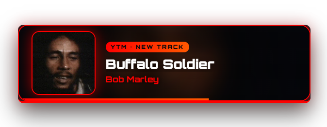
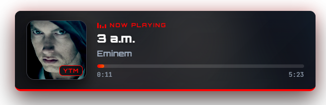

<div align="center">

# 🎵 Music Overlay

**A now-playing overlay for OBS that works with YouTube Music, Spotify, Amazon Music, Apple Music and anything else on Windows.**

238 animated transitions · a visual customizer · Streamer.bot chat announcements · channel-point song requests


</div>

<div align="center">



<sub>**The announce card** — covers the player on every song change, then animates away</sub>

<br><br>



<sub>**The player** — album art, progress, elapsed time, and an accent colour pulled live from the artwork</sub>

</div>

---

## Contents

- [What it does](#what-it-does)
- [How it works](#how-it-works)
- [Requirements](#requirements)
- [Quick start](#quick-start)
- [Setting up the data sources](#setting-up-the-data-sources)
- [Adding it to OBS](#adding-it-to-obs)
- [The effects](#the-effects)
- [Configuration](#configuration)
- [Streamer.bot integration](#streamerbot-integration)
- [Chat commands](#chat-commands)
- [Project layout](#project-layout)
- [Troubleshooting](#troubleshooting)
- [Known limitations](#known-limitations)
- [Credits](#credits)
- [License](#license)

---

## What it does

| | |
|---|---|
| 🎚️ **Two data sources** | A YouTube Music desktop app's API Server for rich track data, plus every other Windows media session — Spotify, Amazon Music, Apple Music, Tidal, browsers — through SMTC Bridge |
| ✨ **238 transitions** | 125 show/hide effects and 113 song-change effects, pick one or randomise from a pool |
| 📣 **Song-change announce** | A card covers the player with the art, artist and title for 10s, then slides away |
| 💤 **Auto-hide** | Disappears after 10s of silence, animates back in when music returns |
| 🚫 **App filter** | Block `chrome.exe` and friends so a YouTube tab can't hijack your overlay |
| 🎨 **Live customizer** | Every setting in a GUI with a real-time preview, no CSS editing |
| 🤖 **Streamer.bot** | Posts `Artist - Title + link` in chat on every song change |
| 🎁 **Song requests** | Channel-point redemptions queued in strict order behind existing requests |
| 🔒 **Fully local** | No account, no cloud, no telemetry |

## How it works

```
┌────────────────────────────┐
│  Pear Desktop        -or-  │
│  CodeMathis/youtube-music  │──┐  HTTP :26538
│  └─ API Server plugin      │  │
└────────────────────────────┘  │     ┌────────────────┐
                                ├────▶│  overlay.html  │────▶  OBS
┌────────────────────────────┐  │     └────────────────┘
│  SMTC Bridge               │  │              ▲
│  ├─ Spotify                │──┘              │
│  ├─ Amazon Music           │   HTTP :5000    │
│  ├─ Apple Music            │        ?cfg=<your settings>
│  └─ Tidal, browsers, …     │                 │
└────────────────────────────┘        ┌───────────────────┐
                                      │  customizer.html  │
┌────────────────────────────┐        └───────────────────┘
│  Streamer.bot (C# actions) │
│  chat + song requests      │────▶  same API Server :26538
└────────────────────────────┘
```

The overlay polls both services once a second, merges them, and shows whichever is actually
playing. Your settings are base64-encoded into the browser-source URL, so there's no server,
no build step and nothing to install.

## Requirements

- **Windows** — SMTC Bridge reads the Windows media-session API, so the non-YouTube-Music sources are Windows-only
- **OBS** (or any Streamlabs/browser-source-capable software)
- **At least one data source** — either works alone, or run both together:
  - a YouTube Music desktop app with the **API Server** plugin — [Pear Desktop](https://github.com/pear-devs/pear-desktop/releases/tag/v3.12.0) or [CodeMathis/youtube-music](https://github.com/CodeMathis/youtube-music)
  - [nuttylmao/smtc-bridge](https://github.com/nuttylmao/smtc-bridge) — for Spotify, Amazon Music, Apple Music and everything else
- **Streamer.bot** — only if you want the chat announcements and song requests
- **Python 3** — only if you need the CORS proxy (ships with Windows Store, or [python.org](https://www.python.org/))

> [!NOTE]
> The overlay itself has no dependencies and no build step. It's plain HTML, CSS and
> vanilla JavaScript — download, open, done.

## Quick start

```text
1. Download or clone this repo anywhere on your PC
2. Start your music source(s) — see "Setting up the data sources" below
3. Open customizer.html in Chrome or Edge
4. Press "Test connection" on the Sources tab until both go green
5. Style it however you like, watching the live preview
6. Press "Copy URL" at the bottom
7. In OBS: Sources → + → Browser → paste the URL → set size to ~900 × 320
```

That's it. To restyle later, tweak the customizer, copy the new URL and paste it over the old one.

## Setting up the data sources

You need at least one. Run both and the overlay merges them, preferring whichever is actually
playing (and you choose the tiebreak on the **Sources** tab).

| Your music | Use | What you get |
|---|---|---|
| **YouTube Music** | a YouTube Music desktop app's API Server | Everything below, **plus** real track links, album art straight from YouTube, and song requests |
| **Spotify** | SMTC Bridge | Title, artist, album, art, play state, position |
| **Amazon Music** | SMTC Bridge | Title, artist, album, art, play state, position |
| **Apple Music** / iTunes | SMTC Bridge | Title, artist, album, art, play state, position |
| **Tidal, Deezer, SoundCloud, foobar2000, VLC, browsers…** | SMTC Bridge | Anything that registers a Windows media session |

### Option A — a YouTube Music desktop app

Two apps work here. Both ship the same **API Server** plugin on the same port with the same
`/api/v1/` endpoints, so the overlay doesn't care which you pick:

| App | Notes |
|---|---|
| **[Pear Desktop](https://github.com/pear-devs/pear-desktop/releases/tag/v3.12.0)** (v3.12.0) | Actively developed. Grab `Pear-Desktop-Web-Setup-3.12.0.exe` for the installer, or the plain `Pear-Desktop-3.12.0.exe` for portable. |
| **[CodeMathis/youtube-music](https://github.com/CodeMathis/youtube-music)** | Also fine if you're already running it. |

1. Install either one
2. In the app: **Plugins → API Server → enable**
3. Note the port — default is **26538** for both
4. Check the plugin's **auth strategy**:
   - **`None`** — easiest, nothing more to do, leave the token blank everywhere
   - **Anything else** — press **Get token** in the customizer and **approve the prompt in the app**, then **restart the app** (otherwise the first requests still return `401`)

Verify in a browser: <http://127.0.0.1:26538/api/v1/song> and <http://127.0.0.1:26538/swagger>

> [!TIP]
> This is the only route that gives you **song requests** and **real clickable track links**,
> because it's the only one exposing a video id and a queue you can insert into.

### Option B — SMTC Bridge, for Spotify / Amazon Music / Apple Music

1. Download the latest release from [nuttylmao/smtc-bridge](https://github.com/nuttylmao/smtc-bridge) and run it
2. A tray icon appears and a local server starts on port **5000**
3. Start playing something in Spotify, Amazon Music or Apple Music — the **App filter** tab in
   the customizer will list the session as soon as it sees it

Verify in a browser: <http://127.0.0.1:5000/now-playing>

SMTC Bridge reads Windows' own media-session API, so it picks up **any** app that registers
one — including ones not listed above. The overlay labels the known services by name (Spotify,
Amazon Music, Apple Music, Tidal, Deezer, SoundCloud…) and falls back to the exe name for
anything else.

> [!NOTE]
> Apple Music on Windows works through either the Microsoft Store **Apple Music** app or
> **iTunes** — both register a media session, and the overlay labels both as *Apple Music*.

> [!IMPORTANT]
> **If YouTube Music works but SMTC Bridge doesn't, it's CORS.** The YouTube Music plugin
> sends `Access-Control-Allow-Origin: *`; SMTC Bridge is a Flask app and doesn't, so the
> browser refuses to hand the JSON to the page even though the request succeeded.
>
> ```bash
> python tools/cors-proxy.py
> ```
>
> Then set the SMTC Bridge URL in the customizer to `http://127.0.0.1:5050`. Leave it
> running while you stream — a shortcut in your startup folder works nicely.

## Adding it to OBS

| Setting | Value |
|---|---|
| **URL** | the URL you copied from the customizer |
| **Width × Height** | ~**900 × 320** for the default bar layout |
| **Shutdown source when not visible** | ❌ off — so it keeps tracking |
| **Refresh browser when scene becomes active** | optional, gives a clean state per scene |

> [!TIP]
> Make the browser source **comfortably larger than the overlay itself**. Effects slide,
> scale and rotate outside the player's own box, and a tight source clips them.

## The effects

<table>
<tr><td>

**125 show/hide**

`Fade` 6 · `Slide` 20 · `Zoom` 8
`3D` 16 · `Rotate` 17 · `Blur` 5
`Wipe` 23 · `Distort` 5
`Bounce` 18 · `Glitch` 7

</td><td>

**113 song-change**

`Reveal` 12 · `Banner` 12 · `Split` 9
`Wipe` 10 · `3D` 11 · `Broadcast` 8
`Impact` 8 · `Cinematic` 10
`Playful` 8 · `Tech` 9 · `Morph` 8 · `Corner` 8

</td></tr>
</table>

Pick one for in and one for out, or tick **Pick a random effect every time** and optionally
restrict it to a pool. In random mode the same effect is used for the pair, so a player that
slid in from the left slides back out to the left.

<details>
<summary><b>Adding your own effects</b></summary>

Both CSS files are generated by `tools/gen_effects.py`. To add one by hand, write a keyframe
pair plus the two classes:

```css
@keyframes fx-in-myeffect  { 0% { opacity:0; transform:rotate(90deg); } 100% { opacity:1; transform:none; } }
@keyframes fx-out-myeffect { 0% { opacity:1; } 100% { opacity:0; transform:rotate(-90deg); } }

.fx-in-myeffect  { animation-name: fx-in-myeffect; }
.fx-out-myeffect { animation-name: fx-out-myeffect; }
```

Then add `{ "name": "myeffect", "cat": "Custom" }` to the matching array in `js/effects.js`
so the customizer lists it. Use the `an-` prefix instead of `fx-` for announce effects.

To regenerate everything from the script instead:

```bash
python tools/gen_effects.py
```

</details>

## Configuration

Seven tabs in the customizer:

| Tab | What's in it |
|---|---|
| **Sources** | URLs, token, which source wins, poll rate, debug readout |
| **App filter** | Block or allow list of program names — the `chrome.exe` setting |
| **Behaviour** | Idle-hide timer, announce on/off and hold duration |
| **Effects** | All 238 effects, durations, easings, random pools |
| **Layout** | Six layouts, anchor, size, which parts show, marquee |
| **Theme** | Panel, colours, album-art accent extraction, Google fonts, type |
| **Announce card** | Card style, art size, background blur/dim, label and type |

<details>
<summary><b>Layouts</b></summary>

| Variant | Description |
|---|---|
| `bar` | Art on the left, text on the right (default) |
| `card` | Large square art on top, text underneath |
| `compact` | Slim bar with smaller art |
| `vertical` | Centred, stacked |
| `minimal` | Text and art only, no panel background |
| `art-only` | Just the album art |

</details>

<details>
<summary><b>App filter — how matching works</b></summary>

Matched against the SMTC `source_app_id`, normally an exe name like `chrome.exe`, sometimes a
Store package id. Blocked out of the box: `chrome.exe`, `msedge.exe`, `firefox.exe`,
`Discord.exe`.

The YouTube Music app itself matches the name `youtube-music`.

The **App filter** tab lists every media session it can currently see, so you click to add
whatever is actually running rather than guessing at names. Switch to **allow list** mode to
name the handful of apps that are permitted instead.

If a blocked app is the "current" session but Spotify is also playing, the overlay picks
Spotify rather than going blank.

</details>

<details>
<summary><b>config.json instead of the URL</b></summary>

`config.json` is an alternative to packing settings into the URL, but browsers refuse to
`fetch()` a local file from a `file://` page, so it only works when the folder is served over
HTTP:

```bash
python -m http.server 8777
```

Then point OBS at `http://127.0.0.1:8777/overlay.html`. The URL method needs no server, so
it's the recommended route. `config.example.json` is an untouched copy of the defaults.

</details>

## Streamer.bot integration

Four standalone C# actions in `streamerbot/`. Each one is pasted into its own
**Sub-Action → Core → C# → Execute C# Code**, replacing whatever snippet is already in the box.

Every file has an **EDIT ME** block of constants at the top — API URL, token, blocked apps,
limits and message templates.

> [!WARNING]
> **Two things will otherwise stop it compiling.**
>
> **1. Don't add the base class.** The class must be named `CPHInline`, and Streamer.bot
> appends `: CPHInlineBase` itself. The files here are plain `public class CPHInline` for
> exactly that reason. If you see `CS1721: cannot have multiple base classes`, something
> re-added it — delete the `: CPHInlineBase` part.
>
> **2. Add the HTTP assembly reference.** C# has no HTTP in its base library, so **exactly
> one** reference is unavoidable. Both versions ship:
>
> | Version | HTTP stack | Reference needed |
> |---|---|---|
> | `streamerbot/01…04` — **try first** | `HttpClient` | `System.Net.Http.dll` |
> | `streamerbot/alt-webrequest/01…04` | `HttpWebRequest` | `System.dll` |
>
> To add it: open the **References** pane in the C# editor, **right-click inside the pane**,
> and add the assembly from the context menu. Also check `Newtonsoft.Json.dll` is listed —
> it ships with Streamer.bot. The **Find Refs** button tries to infer references from the
> `using` directives but doesn't reliably pick up framework assemblies, so add it by hand.
>
> Beyond that one assembly nothing else is needed — the code uses no LINQ, no `Uri`, no
> `ServicePointManager` and no `HttpStatusCode`, each of which would have been another
> reference to get right.

### 01 — Now Playing announcer

Posts `♪ Now playing: Artist - Title <link>` on every song change.

- **Action:** "Now Playing Announce"
- **Trigger:** Settings → **Timed Actions** → interval **3 seconds**, repeat on

Reads the same two services the overlay reads, honours the same block list, and de-duplicates
so a loop or a seek doesn't spam chat.

<details>
<summary><b>About the links</b></summary>

For YouTube Music it uses the real track URL (`https://music.youtube.com/watch?v=…`).
Other platforms expose no local track id, so:

- **Spotify** — fill in `SPOTIFY_CLIENT_ID` / `SPOTIFY_CLIENT_SECRET` (free app at the
  [Spotify dashboard](https://developer.spotify.com/dashboard), no redirect URI needed) and it
  resolves a real `open.spotify.com/track/…` link. Leave blank for a search link.
- **Amazon Music, Apple Music, Tidal, Deezer, SoundCloud** — a search link on that platform.
  A direct track link isn't possible without each platform's own API.

It also writes globals other actions can use: `np_artist`, `np_title`, `np_album`,
`np_platform`, `np_link`, `np_videoId`.

</details>

### 02 — Song request: add

- **Action:** "Song Request Add"
- **Trigger:** Twitch → **Channel Point Reward** → your reward
- Create the reward in the Twitch dashboard with **"Require viewer to enter text" ON**

A viewer types `Daft Punk - Digital Love`. The action searches the YouTube Music app, takes
the best song match and appends it to the request list. It enforces the queue cap, per-user
cap, song-length cap and duplicate check, replies with the queue position, and fulfils or
refunds the redemption accordingly.

### 03 — Song request: pump ⭐

> [!NOTE]
> **This is the part that makes the ordering correct — don't skip it.**

- **Action:** "Song Request Pump"
- **Trigger:** Settings → **Timed Actions** → interval **5 seconds**, repeat on

The YouTube Music API only offers two insert positions, `INSERT_AFTER_CURRENT_VIDEO` and
`INSERT_AT_END`. Neither can place a song at an arbitrary index — pushing three requests with
`AFTER_CURRENT` plays them in **reverse**, and `AT_END` buries them behind the whole autoplay tail.

So Streamer.bot owns the real queue and hands YouTube Music **one request at a time**, always
directly after whatever is playing. The instant that request starts, the next is slotted in
behind it:

```
now playing ──▶ request 1 ──▶ request 2 ──▶ request 3 ──▶ [ new redemption lands here ]
```

Requests play strictly in redemption order, immediately after the current song, and a new
request always lands behind the ones already waiting.

It also announces whose request just started, and drops a slot that never plays (song removed
in the app, queue cleared) after `STALE_MINUTES` so the line keeps moving.

### 04 — Chat commands

One action handles them all — see the table below.

<details>
<summary><b>Globals used</b></summary>

`sr_queue` (the ordered request list, JSON), `sr_count`, `sr_injected` / `sr_injectedAt` (the
request currently handed to YouTube Music), plus the `np_*` set above. All persisted. To wipe
everything, run `!srclear` or clear those globals in Streamer.bot.

</details>

## Chat commands

| Command | Who | Does |
|---|---|---|
| `!song` · `!np` | everyone | What's playing right now, with a link |
| `!queue` · `!sq` | everyone | The next few requests |
| `!wrongsong` | everyone | Removes your own most recent request |
| `!srskip` | mods | Drops the request at the front of the line |
| `!srclear` | mods | Empties the request queue |

Add each in Streamer.bot → **Commands**, all pointing at action **04**.

## Project layout

```
music-overlay/
├─ overlay.html                 ← the OBS browser source
├─ customizer.html              ← open this to style it
├─ config.json                  ← defaults (only read when served over HTTP)
├─ config.example.json
├─ css/
│  ├─ overlay.css
│  ├─ effects-inout.css         ← 125 show/hide effects  (generated)
│  └─ effects-announce.css      ← 113 song-change effects (generated)
├─ js/
│  ├─ effects.js                ← effect manifest        (generated)
│  ├─ config.js                 ← defaults, URL encode/decode
│  ├─ sources.js                ← YouTube Music + SMTC connectors
│  ├─ overlay.js                ← runtime, state machine, theming
│  └─ customizer.js             ← settings UI
├─ tools/
│  ├─ cors-proxy.py             ← if SMTC Bridge is blocked by CORS
│  └─ gen_effects.py            ← regenerates the effect libraries
└─ streamerbot/
   ├─ 01_NowPlayingAnnounce.cs  ← HttpClient versions — try these first
   ├─ 02_SongRequest_Add.cs
   ├─ 03_SongRequest_Pump.cs
   ├─ 04_SongRequest_Commands.cs
   └─ alt-webrequest/           ← HttpWebRequest fallback, needs System.dll
```

## Troubleshooting

<details>
<summary><b>The overlay never appears</b></summary>

Turn on **Sources → Show debug readout** and reload the browser source. It prints the active
source, the track and any connection error in the corner.

</details>

<details>
<summary><b>401 Unauthorized from YouTube Music</b></summary>

The API Server auth strategy isn't `None` and the token is missing or stale. Press **Get
token** in the customizer, accept the prompt in the app, then **restart the YouTube Music app**.

</details>

<details>
<summary><b>SMTC test says "Failed to fetch" but the URL works in my browser</b></summary>

That's CORS. Run `python tools/cors-proxy.py` and point the bridge URL at
`http://127.0.0.1:5050`.

</details>

<details>
<summary><b>Effects get cut off at the edges</b></summary>

The OBS browser source is too small. Effects animate outside the player's own box, so make the
source a few hundred pixels wider and taller than the player.

</details>

<details>
<summary><b>A browser tab keeps taking over the overlay</b></summary>

Add its exe to the **App filter** list. The tab shows you the exact `source_app_id` currently
reporting, so you don't have to guess.

</details>

<details>
<summary><b>Song requests find the wrong song</b></summary>

`POST /api/v1/search` returns YouTube Music's own search payload and the action walks it for
the first proper song row. Ask viewers for `Artist - Title` rather than a bare title, and
check Streamer.bot's log tab — the action logs what it matched.

</details>

<details>
<summary><b>Nothing queues at all</b></summary>

Check the Streamer.bot log for `[SR] POST /api/v1/queue`. If it 404s, your build of the app
predates the queue endpoint — update it.

</details>

<details>
<summary><b>C# won't compile / reference errors</b></summary>

See the warning in [Streamer.bot integration](#streamerbot-integration). In short: use the
files in `streamerbot/` (not `alt-webrequest/`) and add `System.Net.Http.dll` via the
References pane. The line numbers in the error messages tell you which copy you actually
pasted — `alt-webrequest/01_NowPlayingAnnounce.cs` has `using System.Net;` on line 39, the
main file has `public class CPHInline` there.

If **neither** assembly will resolve, that's the Streamer.bot install rather than the code —
worth asking in the Streamer.bot Discord, mentioning that a plain `using System.Net;` fails to
compile for you.

</details>

## Known limitations

- **The EQ bars are decorative.** A browser source can't read your system audio, so they
  animate while something is playing rather than reacting to it.
- **Album-art accent extraction** needs the art readable by a canvas. YouTube Music art and
  SMTC base64 thumbnails both work; if an exotic source blocks it, the overlay quietly keeps
  your configured accent colour.
- **Positions and durations** come from whatever the source reports, interpolated between
  polls. SMTC-only apps sometimes report a stale position after a seek; it corrects on the
  next poll.
- **Direct track links** only exist for YouTube Music, and for Spotify if you supply API
  credentials. Everything else gets a search link.
- **Windows only** for the SMTC sources. The YouTube Music API Server path would work
  cross-platform, but SMTC Bridge is a Windows media-session API consumer.

## Credits

This project talks to these tools over HTTP — it bundles no code from any of them:

- **[Pear Desktop](https://github.com/pear-devs/pear-desktop)** — actively developed YouTube Music desktop app; its API Server plugin provides the richest track data and the queue that song requests depend on
- **[CodeMathis/youtube-music](https://github.com/CodeMathis/youtube-music)** — same API Server plugin, equally supported
- **[nuttylmao/smtc-bridge](https://github.com/nuttylmao/smtc-bridge)** — exposes every Windows media session, which is what makes Spotify, Amazon Music and Apple Music possible

Built for [OBS](https://obsproject.com/) and [Streamer.bot](https://streamer.bot/).

## License

<!-- Pick one and drop a LICENSE file in the repo root.
     MIT is the usual choice for something like this: https://choosealicense.com/licenses/mit/ -->

No license chosen yet — add a `LICENSE` file to the repo root. Until then, default copyright
applies and others technically can't reuse it. [choosealicense.com](https://choosealicense.com/)
is a good 30-second decision.

---

<div align="center">
<sub>Everything runs locally. No account, no cloud, no telemetry — the only outbound requests are Google Fonts for your chosen font, and the optional Spotify link lookup.</sub>
</div>
